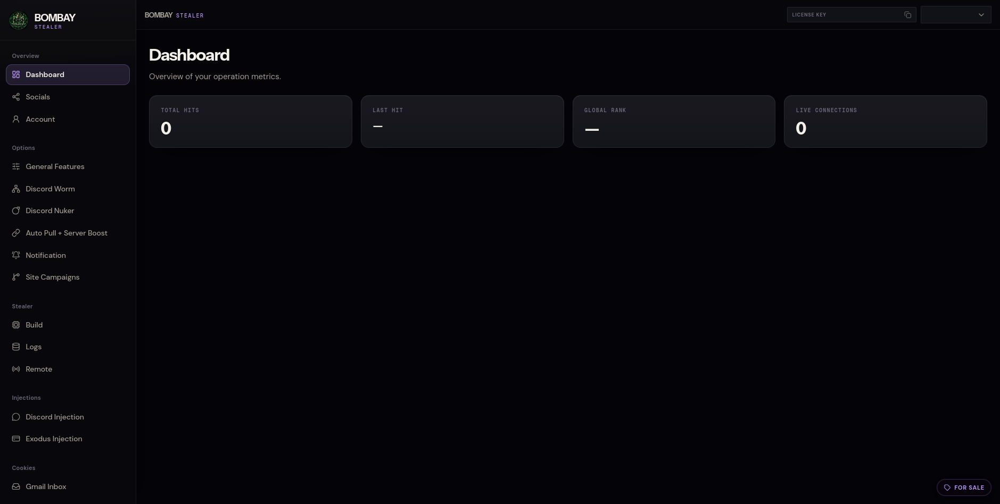
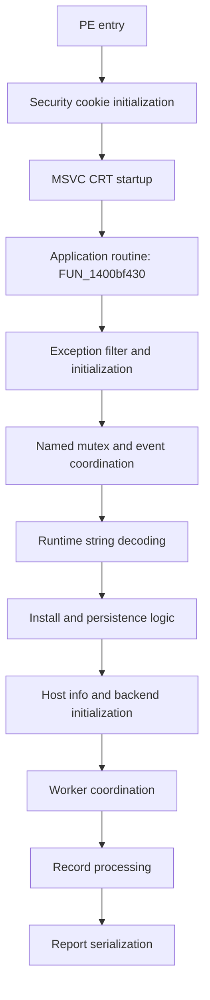

# From a Fake Minecraft Mod to Bombay Stealer: A Reverse Engineering Walkthrough

> **Scope:** Independent static reverse engineering of a Windows executable I generated from a publicly reachable Bombay Stealer web panel. The suspicious Minecraft mod that led me there is a **separate artifact**. No malware binaries, credentials, live operator configuration, or functional payloads are included in this repository.

## TL;DR

I started by investigating a suspicious Minecraft mod advertised in a Discord server offering game cheats. Its behavior led me to a URL that redirected to a panel branded **Bombay Stealer**. I created a test account, inspected the panel, and generated a Windows executable named `FortniteCheat.exe` for isolated reverse engineering in Ghidra.

The resulting x64 native executable uses an MSVC-compatible runtime, constructs several API names at runtime, implements named-mutex coordination, decodes short strings with changing XOR keys, attempts user-level persistence through `%LOCALAPPDATA%` and an `HKCU` Run entry, and coordinates multiple worker routines. I also found code paths that process credential-like records and format them into text reports. My static observations do **not** establish that data was successfully exfiltrated or that every advertised panel feature works.



> **Research ethics:** I accessed the panel for investigation only. I did not use it to infect third-party systems. I also reported the website to CERT Polska, Cloudflare, and Google Safe Browsing. These are my submissions, not claims that any provider confirmed or completed remediation.

## Contents

- [1. How I found it](#1-how-i-found-it)
- [2. Sample provenance and scope](#2-sample-provenance-and-scope)
- [3. PE entry point and MSVC runtime](#3-pe-entry-point-and-msvc-runtime)
- [4. Application entry routine](#4-application-entry-routine)
- [5. Runtime string construction and XOR decoding](#5-runtime-string-construction-and-xor-decoding)
- [6. Single-instance coordination](#6-single-instance-coordination)
- [7. Install-path detection and persistence](#7-install-path-detection-and-persistence)
- [8. Dynamic Windows API resolution](#8-dynamic-windows-api-resolution)
- [9. File handling and the BND! marker](#9-file-handling-and-the-bnd-marker)
- [10. Worker coordination and execution timeouts](#10-worker-coordination-and-execution-timeouts)
- [11. Credential-related data processing and deduplication](#11-credential-related-data-processing-and-deduplication)
- [12. Password report serialization](#12-password-report-serialization)
- [13. Indicators and detection notes](#13-indicators-and-detection-notes)
- [14. What remains unverified](#14-what-remains-unverified)
- [15. Conclusion](#15-conclusion)

## 1. How I found it

I was looking for interesting malware samples to reverse engineer and came across a Discord server calling itself **Cheat HUB | #1 Free Cheats** (`discord.gg/cheato` was the advertised invite at the time of my investigation). The server listed downloads for multiple games. Its Minecraft section, for example, advertised names such as *Litematica*, *Meteor Client*, *Iris Shaders*, and *Sodium*. Some of these names are associated with legitimate Minecraft tools; their appearance on a suspicious distribution server does **not** mean the original projects are malicious.

I chose a file presented as a **Litematica `.jar`**. The archive looked strange: it contained many repetitive-looking modules and inconsistent obfuscation. The noteworthy behavior was not the functionality advertised by the mod. In my initial examination, loading the mod led to PowerShell, which invoked an **HTA (HTML Application)**. The HTA appeared designed to make its window unobtrusive: it removed its taskbar presence, moved the window far off-screen (roughly `-30000, -30000`), resized it to `0 × 0`, and started three VBScript files with randomized filenames in a randomized directory.

I am deliberately not reproducing the original launcher command or the scripts here. This section describes my observations of the **initial lead**; the underlying JAR, command-line capture, and VBS contents are not part of this repository. I would need those artifacts to document the complete chain from mod loading to subsequent execution.

Out of curiosity, I opened a URL found during that investigation in a regular browser. Instead of the generic server landing page I had expected, I was redirected to a login portal for **Bombay Stealer**. I registered using test details and was presented with a dashboard and menu entries including **Build**, **Logs**, **Remote**, **Discord Worm**, and injection-related options. Those are **labels exposed by the interface**, not independently validated capabilities.

I then used the panel to **generate `FortniteCheat.exe` myself**, specifically so I could examine that binary in Ghidra. This distinction matters: the `.jar` was the discovery vector, whereas `FortniteCheat.exe` is a separate, builder-generated sample and the subject of the PE analysis below. I am not asserting that the Discord-distributed JAR contained this exact executable.

## 2. Sample provenance and scope

| Property | Observation |
| --- | --- |
| Primary analyzed filename | `FortniteCheat.exe` |
| Where it came from | I generated it in the Bombay Stealer web builder |
| Entry-point analysis | Ghidra decompiler |
| Format | PE32+ / x86-64 Windows GUI |
| Runtime | Native C++, MSVC-compatible startup and STL implementation patterns |
| Ghidra library match | `__scrt_common_main_seh` - **Visual Studio 2019 Release**, single match |
| SHA-256 | `b900ce5426fe22e5e359d176570a9d61ce0b2f9e1d460c1e49e8fa07f561d278` |
| Full dynamic trace / PCAP | Not available in this write-up |
| Relationship to the `.jar` | Linked by my investigation, **not** established as identical payloads |

The Ghidra signature is a useful runtime fingerprint, but it does not prove that the entire program was compiled with one exact version of Visual Studio. The function addresses below are **virtual addresses from this analyzed image**, not portable signatures across builds.

### High-level execution map



This is an **analyst's simplified reading path**, not a claim that all blocks execute unconditionally or strictly in this order on every run.

## 3. PE entry point and MSVC runtime

I began at Ghidra's `entry` function:

```c
void entry(void)
{
    FUN_140205d18();
    __scrt_common_main_seh();
    return;
}
```

The first call, `FUN_140205d18`, is consistent with the standard MSVC `__security_init_cookie` routine. It uses `GetSystemTimeAsFileTime`, `GetCurrentThreadId`, `GetCurrentProcessId`, and `QueryPerformanceCounter`, combines their values, masks the result to 48 bits and stores the bitwise complement of the cookie. The default comparison constant is `0x2b992ddfa232`. This is compiler-generated stack-protection initialization, **not** evidence of a custom malware random-number generator or anti-sandbox check.

Ghidra matched `__scrt_common_main_seh` to a **Visual Studio 2019 Release** runtime function. Also `_guard_dispatch_icall` was replaced by a decompiler injection; that refers to Ghidra's modeling of Control Flow Guard-related indirect calls and is **not process injection**.

After the CRT startup path, the program reaches `FUN_1400bf430`. Unlike the security-cookie routine, this function contains a substantial amount of sample-specific logic.

## 4. Application entry routine

`FUN_1400bf430` is a large function (more than 2,000 lines in my exported decompilation). Rather than copying its entire output into this report, I grouped its observable responsibilities:

| Evidence | Interpretation |
| --- | --- |
| `SetUnhandledExceptionFilter(FUN_1400a4d30)` | Registers an exception filter |
| `FUN_1400dd140(...)` and `CreateEventA(...)` | Named-object/single-instance coordination |
| XOR loop referencing `DAT_14025d768` | Runtime decoding of a diagnostic string |
| `FUN_1400e7d90()` | Attempts installation and persistence |
| `GetComputerNameW`, registry reads | Retrieves host-identifying context |
| Repeated worker callbacks and `std::_Ref_count_obj2<std::mutex>` | Concurrent task coordination |
| `FUN_1400d0780(...)` then `FUN_1400d46e0(...)` | Record processing followed by report formatting |

### Exception handler: less exotic than it first looks

The registered handler is almost trivial:

```c
undefined8 FUN_1400a4d30(void)
{
    return 1;
}
```

For the Windows unhandled-exception filter callback, `1` is `EXCEPTION_CONTINUE_SEARCH`. It requests further exception processing rather than demonstrating custom exception recovery. On its own, this is **not** enough to claim anti-debugging.

### Host metadata

The function calls `GetComputerNameW` and also accesses registry values in a path assembled as `SOFTWARE\Microsoft\Windows NT\CurrentVersion`, including `ProductName`. These calls help characterize the local system, but the subsequent use of each value should not be assumed without following the relevant worker and reporting code.

## 5. Runtime string construction and XOR decoding

The program often builds plaintext strings from small integer assignments to thread-local buffers, instead of storing one contiguous string literal. Other strings are decoded from static byte sequences at runtime.

### The `0x33` decoder

The first clearly visible XOR loop is in `FUN_1400bf430`:

```c
// Compact, analyst-normalized representation of the observed logic.
byte key = 0x33;
for (size_t i = 0; i < 0x3d; ++i) {
    destination[i] = encoded_source[i] ^ key;
    key = (key + i) & 0x7f;
}
```

The source is referenced near `DAT_14025d768`; importantly, the **decoded output is written into a thread-local destination buffer**, not back over the encoded source. Using the 61-byte sequence recorded in my detection notes yields:

```text
Failed to initialize syscalls - falling back to standard APIs
```

The caller passes the decoded value to `FUN_1400e3800`, which appears in other message/reporting paths. The text could be diagnostic, misleading, or both. I did **not** establish an intentional sandbox deception mechanism from this string alone.

### Other forms of string decoding

In the same main function, a second decoder starts with `0x21` and processes several bytes per iteration. A registry-related helper (`FUN_1400e5ed0`) also contains a **16-bit XOR transformation**, starting with `0x1c` and masking intermediate values with `0x7fff`. These are observable implementation differences; they do not necessarily represent separate cryptographic systems.

I would describe this as **runtime string obfuscation**, not as strong encryption.

## 6. Single-instance coordination

A useful finding came from `FUN_1400dd140`. It uses a **named mutex** and checks `GetLastError()` against `0xb7` (`ERROR_ALREADY_EXISTS`):

```c
HANDLE mutex = CreateMutexA(NULL, FALSE, name);
if (mutex != NULL && GetLastError() != ERROR_ALREADY_EXISTS) {
    return mutex;
}
```

The real routine has more branches than this simplified excerpt. When an existing mutex is detected, it tries `OpenEventA` and signals a named event via `SetEvent`, then enters a bounded retry sequence. The decompiled retry loop has a limit of `0x28` (40) iterations. This gives the sample a way to coordinate competing instances; it is **not** 40 attempts to contact a server.

The exact mutex and event names have not been recovered for this report. Logging strings such as `Single-instance mutex unavailable` independently support the same interpretation, but the Windows API calls are the stronger evidence.

## 7. Install-path detection and persistence

This is the best-supported host-artifact section of my analysis.

### 7.1 Installation-path check: `FUN_1400e2180`

This function retrieves the current executable path with `GetModuleFileNameW` and constructs the suffix:

```text
\WindowsRecovery\Update.exe
```

It then compares the **end** of the current path with that suffix, using a case-insensitive comparison helper. This is not the same thing as checking that the file actually lives inside `%LOCALAPPDATA%`.

The result changes a loop bound in `FUN_1400bf430`: one branch uses **10** iterations and the other **36**. These are the bounds of a later initialization loop, not necessarily 10 or 36 successful network connection attempts.

### 7.2 Installation and file staging: `FUN_1400e7d90`

The function assembles these host artifacts:

```text
%LOCALAPPDATA%\WindowsRecovery\
%LOCALAPPDATA%\WindowsRecovery\Update.exe
```

The code references `CreateDirectoryW`, `SetFileAttributesW`, `DeleteFileW` and `MoveFileExW`. In the observed call, the last function receives flags `9`, corresponding to `MOVEFILE_REPLACE_EXISTING | MOVEFILE_COPY_ALLOWED`. The operation may **move** the file or use a copy-and-delete fallback across volumes; calling it a guaranteed copy would be inaccurate.

The `SetFileAttributesW` calls use `0x80` (`FILE_ATTRIBUTE_NORMAL`), **not** `FILE_ATTRIBUTE_HIDDEN`. This matters because my initial description of the installation as a hidden file was too strong.

There are conditional branches and file-replacement/failure paths, so static code review confirms an **attempted installation procedure**, not that the procedure succeeded in a specific execution.

### 7.3 HKCU Run persistence: `FUN_1400e5ed0`

The registry helper assembles the following subkey:

```text
Software\Microsoft\Windows\CurrentVersion\Run
```

The call uses `0x80000001`, the predefined handle for `HKEY_CURRENT_USER`, and its caller supplies the value name `WindowsRecovery`. The helper surrounds the staged path with quotes before passing it into the registry-write path. This is consistent with a per-user logon autorun entry pointing to the staged executable.

The complete observed indicator set is:

| Field | Value |
| --- | --- |
| Registry hive | `HKEY_CURRENT_USER` |
| Subkey | `Software\Microsoft\Windows\CurrentVersion\Run` |
| Value name | `WindowsRecovery` |
| Target executable | `%LOCALAPPDATA%\WindowsRecovery\Update.exe` |
| ATT&CK mapping | [T1547.001 - Registry Run Keys / Startup Folder](https://attack.mitre.org/techniques/T1547/001/) |

This is **registry Run-key persistence, not Windows service installation**.

## 8. Dynamic Windows API resolution

Following a reference to the global pointer `DAT_140317b08` led me to an initializer at `FUN_140074a00`. This routine reconstructs `advapi32.dll` as a UTF-16 string, tries `GetModuleHandleW`, and falls back to `LoadLibraryW` if needed. It then assembles individual API names and resolves them using `GetProcAddress`.

One decisive assignment is:

```c
DAT_140317b08 = GetProcAddress(moduleHandle, "RegSetValueExW");
```

I traced this global pointer into `FUN_140075380`, a six-argument wrapper that invokes the saved address. The match confirms that the persistence helper ultimately reaches **`RegSetValueExW`**, instead of merely calling an unknown registry-like function.

The same resolver references these APIs:

| Group | Resolved names |
| --- | --- |
| Registry operations | `RegOpenKeyExA`, `RegOpenKeyExW`, `RegQueryValueExA`, `RegQueryValueExW`, `RegCloseKey`, `RegCreateKeyExW`, `RegSetValueExW` |
| Token operations | `OpenProcessToken`, `LookupPrivilegeValueW`, `AdjustTokenPrivileges` |
| Security descriptors | `InitializeSecurityDescriptor`, `SetSecurityDescriptorDacl` |
| Identity | `GetUserNameW` |

It sets `DAT_140317ad0 = 1` only when all expected entries resolve; otherwise the final flag is set to `0`. These functions will not necessarily all appear as **direct imports** in the PE import table. Dynamic resolution and runtime string assembly complicate simple string/import-based static analysis, but neither technique alone proves EDR evasion.

### Two string-comparison paths

`FUN_1402161e0` has an ASCII-oriented case-insensitive comparison loop; another path calls `FUN_140216250`, which uses CRT locale-related character-mapping tables. The first export was shown by Ghidra with a `void` return type even though its callers test a result. That mismatch is a useful reminder that **decompiler signatures are hypotheses** and should be checked against the call sites and assembly.

## 9. File handling and the `BND!` marker

The file-handling layer includes `FUN_1400e3d50`, which initializes Unicode paths with `RtlInitUnicodeString` and delegates to several internal native-API-like wrappers. If the expected function pointers or state are unavailable, it falls back to `FUN_1400dcc40`.

The fallback is recognizable as a conventional, read-only Windows file-mapping sequence:

```c
CreateFileW(..., GENERIC_READ, ..., OPEN_EXISTING, ...);
GetFileSizeEx(...);
CreateFileMappingW(..., PAGE_READONLY, ...);
MapViewOfFile(..., FILE_MAP_READ, ...);
```

It validates file size before mapping and stores the resulting handles, view, and size in an internal structure. This verifies the **Win32 file-mapping fallback**, not the claim that the first path uses custom direct syscalls. That would require inspecting the native wrappers themselves.

### Possible appended data

In `FUN_1400e7d90`, an adjacent branch examines a file-associated buffer for a four-byte marker:

```text
BND!
```

The byte value is `0x21444e42` when represented as a little-endian 32-bit integer. The code also reads a trailing length-like field. This is consistent with a structured trailer or appended data format, but I have **not** established the exact content, the builder's format, or a complete parser. I would not label it an extracted configuration without more evidence.

## 10. Worker coordination and execution timeouts

The largest application-specific routine I reviewed, `FUN_1400bf430`, acts as an orchestrator. It creates numerous execution tasks through the internal function `FUN_1402164ec`, passing callback addresses such as `FUN_1400b4af0`, `FUN_1400b4b70` and `FUN_1400b4d70`. The decompilation also contains reference-counted C++ objects, synchronization structures identified as `std::_Ref_count_obj2<std::mutex>`, and atomic increments/decrements.

These observations support **concurrent task execution with shared state**, although they do not by themselves reveal the precise function of each worker. I have not labeled a specific callback a browser extractor, uploader, or remote-control task without tracing its implementation.

The main routine contains two time-bounded waits. Both use `GetTickCount64` and check an outstanding-work counter:

```c
// Simplified representation of the observed waiting condition.
while (pending_count > 0 && GetTickCount64() - start < 900000) {
    // Wait for outstanding work.
}
```

One limit is **900,000 ms (15 minutes)**, followed by a separate **120,000 ms (2 minutes)** interval. A later path emits a timeout-related message if work remains pending. These are observable execution limits, not evidence by themselves of sandbox evasion. The program also resolves `Sleep` dynamically from `kernelbase.dll` on paths used while waiting.

The subsequent call flow is particularly useful for placing the credential-related routines in context:

```c
FUN_1400d0780(&local_288, local_5b8 + 0xc, local_5b8, local_698);
FUN_1400d46e0(&local_4b8, local_5b8 + 0xc, local_5b8);
```

The calls occur in sequence in the same main routine. However, their inputs and outputs are different: the first builds a deduplicated **Brute.txt-related** artifact, while the second formats structured records into a **Passwords.txt-related** report. I do not assume the password report is built from the first routine's deduplicated output.

## 11. Credential-related data processing and deduplication

### 11.1 Why I inspected `FUN_1400d0780`

I initially suspected a C++ red-black tree from the size and layout of allocated objects. Reviewing the full decompilation of `FUN_1400d0780` provided substantially stronger evidence. The routine allocates a **`0x40`-byte (64-byte)** node and initializes three pointer fields to point to itself:

```c
plVar7 = (longlong *)FUN_1402051a8(0x40);
*plVar7    = (longlong)plVar7;
plVar7[1] = (longlong)plVar7;
plVar7[2] = (longlong)plVar7;
*(undefined2 *)(plVar7 + 3) = 0x101;
```

This is consistent with the header/sentinel node of the MSVC STL red-black tree implementation. The following layout matches the observable node offsets:

| Offset | Reconstructed field | Basis |
| --- | --- | --- |
| `+0x00` | Left-child pointer | Node access and traversal |
| `+0x08` | Parent pointer | Node access and traversal |
| `+0x10` | Right-child pointer | Node access and traversal |
| `+0x18` | Color and sentinel metadata | Byte accesses and initial `0x0101` value |
| `+0x20` | Embedded string-like value | String copy, comparison and destruction |
| Total | `0x40` bytes | Heap allocation and node deallocation |

The container is **consistent with `std::set<std::string>`**, but the original source-level template type has not been recovered from symbols. I therefore treat the precise C++ type as a high-confidence reconstruction rather than a directly observed declaration.

### 11.2 Ordered insertion and duplicate suppression

The function iterates over a collection whose records are separated by `0xC0` bytes. It chooses a candidate string at either `+0x40` or `+0x60` within a record, depending on a field at `+0x70`, and skips candidates whose string length is zero. That selection pattern also appears in the password-report serializer.

When searching the tree, it compares the candidate value with an existing node's string using `memcmp`. The comparison is limited to the shorter length; additional branches consider length equality and ordering:

```c
_Size = uVar12;
if (uVar16 < uVar12) {
    _Size = uVar16;
}
iVar5 = memcmp(plVar14, puVar8, _Size);
```

The traversal and conditional insertion through `FUN_14003c610` are characteristic of an **ordered set with unique keys**. This supports deduplication of string values, not necessarily deduplication of complete credential records or of every field in the source records.

The code does not prove that `memcmp` is being used as a security check; here it is part of ordinary string ordering.

### 11.3 Output artifact and memory cleanup

If the resulting tree is empty, the routine takes a branch referencing the internal name `brute_txt`. Otherwise, it traverses the populated tree, writes string values to a stream, retrieves the accumulated text through `FUN_1400d7c40`, and associates the output with **`Brute.txt`** and the `brute_txt` identifier through downstream helper calls.

The exact semantics of the artifact-packaging helper `FUN_14003e440` remain unverified. The code supports **construction and packaging of a named text artifact**; it does not prove its network transmission.

After processing, the function destroys its tree nodes and releases allocated memory:

```c
FUN_14003cd60(plVar11 + 4);
FUN_1402051e4(plVar11, 0x40);
```

The first call is consistent with destruction of the stored string object, and the second with heap deallocation. I found **no explicit evidence of secure wiping of the string contents** before release. It would be inaccurate to characterize these ordinary cleanup operations as anti-memory forensics.

## 12. Password report serialization

### 12.1 Function purpose and record stride

`FUN_1400d46e0` is a separate report-generation routine that walks the same class of `0xC0`-byte (192-byte) records and builds an indexed, readable text report. Its primary evidence is not a function name but the assembled field labels, fallback values, and calls to stream-formatting helpers.

The following **partial record layout** is supported by the accesses in the decompiled function:

| Record offset | Observed interpretation | Confidence |
| --- | --- | --- |
| `+0x00` | Username-associated string | High |
| `+0x20` | Password-associated string | High |
| `+0x40` or `+0x60` | Alternative string value selected using a condition at `+0x70` | High for selection; purpose uncertain |
| `+0x70` | Field controlling the alternate-string selection | High for use; exact type uncertain |
| `+0x80` | Browser or source label | High |
| `+0xA0` | Profile or additional context label | Moderate |
| `+0xC0` | Record stride | High |

This is a description of accessed offsets, **not** a complete recovered C++ structure definition. In particular, I have not named the conditional `+0x40`/`+0x60` field because its origin and exact meaning remain unknown.

### 12.2 Missing-value handling

The serializer substitutes visible default strings when fields are missing:

- `N/A` for empty username- and password-related fields;
- `Unknown` for an empty browser/source label;
- `Default` for an empty additional profile/context label.

These substitutions are directly visible in `FUN_1400d46e0` and are not inferred from the panel's user interface.

### 12.3 Human-readable report structure

The routine initializes a counter at **1**, formats a bracketed index, appends the relevant strings, and increments the counter for each emitted record. It constructs the labels `Username:`, `Password:`, and `Browser:` from short fragments stored in thread-local memory.

A **representative, synthetic** rendering of the output is:

```text
[1]
    Username: demo_user
    Password: example_only_not_a_real_password
    Browser: ExampleBrowser (Default)

[2]
    Username: another_demo_user
    Password: synthetic_value
    Browser: ExampleBrowser (Profile 1)
```

The example is for illustrating field order and content only; it is not a dump from a victim system, and minor spacing may differ from the exact stream output.

The main report-building loop uses stream-related helpers including `FUN_1400c9560`, `FUN_1400ca9c0` and `FUN_1400c9f50`. When the stream is complete, `FUN_1400d7c40` extracts its contents, and `FUN_14003e440` associates the resulting buffer with the output name **`Passwords.txt`** and internal identifier **`passwords_txt`**.

### 12.4 What this proves - and what it does not

The function is compelling evidence for **credential-record formatting and in-memory report construction**. It also shows an output-artifact boundary that could be useful when tracing the rest of the program.

It does **not**, on its own, establish a destination domain, a network protocol, an upload operation, or successful exfiltration. In the absence of a verified downstream network call chain or traffic capture, I make no such claims.

## 13. Indicators and detection notes

These indicators come from static analysis and should be correlated with process, file and registry telemetry. Several are not unique by themselves.

| Type | Candidate indicator | Confidence / caveat |
| --- | --- | --- |
| Staged path | `%LOCALAPPDATA%\WindowsRecovery\Update.exe` | Strongly supported intended path; may be reused by unrelated software |
| Staging folder | `%LOCALAPPDATA%\WindowsRecovery` | Intended destination, not standalone proof |
| Autorun entry | `HKCU\Software\Microsoft\Windows\CurrentVersion\Run` → `WindowsRecovery` | Supported by helper and API resolver |
| Encoded text bytes | 61-byte sequence associated with `DAT_14025d768` | Specific static candidate, requires testing against the EXE |
| Decoded text | `Failed to initialize syscalls - falling back to standard APIs` | Runtime string; may not appear as plaintext on disk |
| Other text artifacts | `Backend initialization retry...`, `Single-instance mutex unavailable` | Contextual only, not unique signatures |
| Trailer marker | `BND!` | Meaning and prevalence unconfirmed |

### Useful defensive validation

For investigation in an authorized environment, I would prioritize: a process tree connecting the launched image to its installation attempt; the resolved `WindowsRecovery` file path; creation or modification of the relevant `HKCU` Run value; and any associated network activity. Finding an exact filename alone is not sufficient evidence of compromise.

## 14. What remains unverified

I want to keep the distinction between an observation and a plausible explanation explicit:

1. **NOX lineage.** My earlier working notes described Bombay as a NOX Stealer rebrand, but I do not currently have a source-code comparison or independently verified attribution. I am treating this as **unconfirmed** rather than using it in the article title.
2. **Dual-hooking.** A free builder does **not** prove that generated files send data to both a customer and the service operator. Demonstrating that would require evidence from configuration or actual traffic, neither of which is included here.
3. **Network exfiltration.** The record-serialization code is visible; a demonstrated network send path and destination are not.
4. **Original mod-to-builder relationship.** The suspicious `.jar` is how I discovered the panel. I have not demonstrated that the JAR contains the exact builder-generated `FortniteCheat.exe`.
5. **The `BND!` trailer.** Its precise format and semantics remain unknown.
6. **Compiler attribution.** The Visual Studio 2019 Release library match is a helpful clue, not a complete build provenance record.
7. **Runtime success of persistence.** The code attempts staging and registry modification; a dynamic trace is needed to verify successful installation on a host.

## 15. Conclusion

What began as a look at a suspicious Minecraft download led me to a malware-branded web panel and then to a Windows executable I generated specifically for analysis. The Ghidra work uncovered a fairly conventional native C++ application architecture wrapped around runtime-built strings, dynamic API resolution, concurrency, named-object coordination, file-mapping fallbacks, and a clear user-level persistence attempt.

The most defensible technical conclusions are the **MSVC-style startup**, the **mutex/event coordination**, the **XOR-decoded string**, the **constructed `%LOCALAPPDATA%\WindowsRecovery\Update.exe` path**, the **HKCU Run-key registration path backed by a resolved `RegSetValueExW` pointer**, and the **ordered invocation of record processing and report formatting**. My review of the complete record-processing functions also supports **red-black-tree-based string deduplication**, **`Brute.txt`-related artifact construction**, and **indexed `Passwords.txt` report serialization**. These findings are reproducible from the supplied pseudocode. Claims about actual outbound theft, family lineage, dual-hooking, or anti-forensic intent require additional proof.

I am publishing the analysis so that others can recognize these implementation patterns and understand how the evidence was established, without redistributing the malware or presenting speculation as fact.

---

*Tools: Ghidra: static reverse engineering of a test build generated from the observed interface. All screenshots and code excerpts are limited to non-operational analysis. The screenshot is redacted to remove account/license details.*
